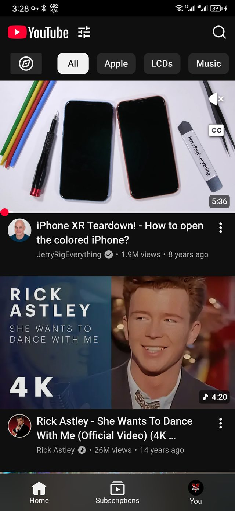
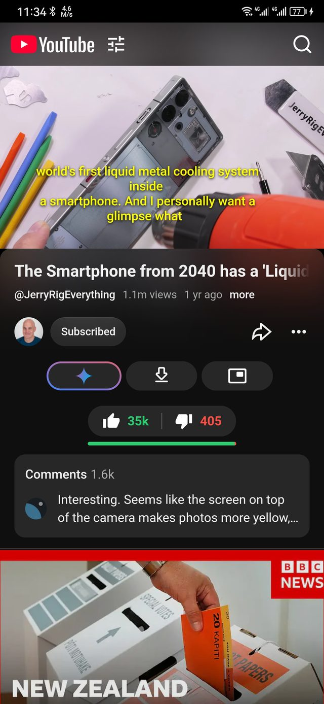
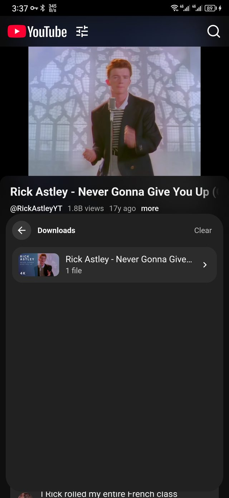
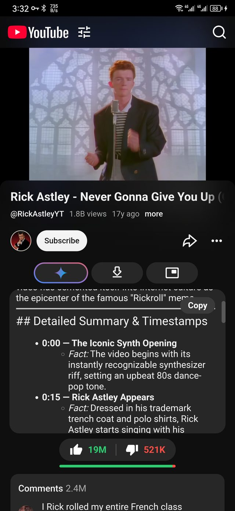
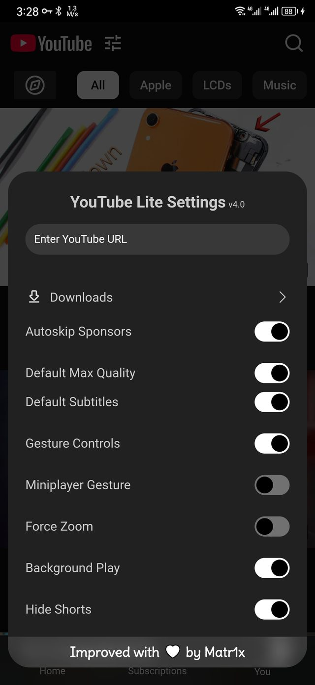
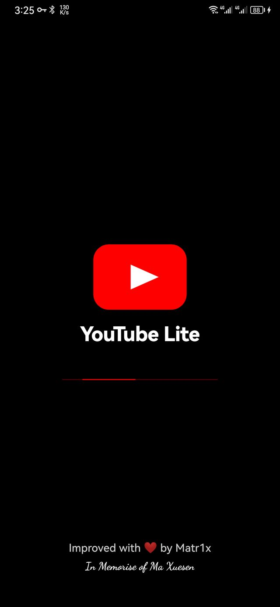

<p align="center">
  
</p>
<h1 align=center>YouTube Lite</h1>

<div align="center">


</div>

A clean, lightweight YouTube client for Android. YouTube Lite wraps the YouTube mobile web app in a hardened WebView and adds the features power users actually miss — ad blocking, background audio, gestures, a full download manager, Gemini summaries, system-caption integration and a distraction-free UI. No root, no Xposed, no system modifications, no GMS services required.

## Download YouTube Lite

### Prebuilt APK

Grab the latest signed build from **[Releases](https://github.com/danielmzy/YouTube-Lite/releases/latest)** — for example `YouTube_Lite-V1.1.apk`.

* Android 5.0+ (API 21)
* Installs side by side with the original YTPro

### Build from source

Prefer to compile it yourself? Nothing else is required:

```bash
git clone https://github.com/danielmzy/YouTube-Lite.git
cd YouTube-Lite
./gradlew assembleDebug
# APK: app/build/outputs/apk/debug/app-debug.apk
```

Requirements: JDK 17, Android SDK 36 (compileSdk 36, minSdk 21). See [BUILDING.md](BUILDING.md) for Android Studio steps and release signing.

> **Updates** — YouTube Lite can download and install new releases directly; see [Updater](#features).

> **Installs side by side with the original YTPro.** YouTube Lite uses the applicationId `com.matr1x.youtubelite`, while [prateek-chaubey/YTPro](https://github.com/prateek-chaubey/YTPro) uses `com.google.android.youtube.pro`. Both can stay installed on the same phone, update independently and keep separate app data.

#### Screenshots

| Home | Watch page | Downloads |
|:--:|:--:|:--:|
||||
| **Gemini summary** | **Settings** | **Startup** |
||||

## Features

* **Google Gemini**
  * Summarise the current video
  * Customisable prompts and models
  * Copy the answer with one tap, independent scrolling panel
* **Downloader**
  * Video (up to 4K), audio-only, thumbnails and captions
  * In-built video + audio muxer (MP4, on-device)
  * Download manager with history, per-video grouping and live speed
  * Long-press any downloaded file for **Open / Share / Delete**
  * Files saved to `Download/Youtube Lite/<video title>/`
* **Desktop-grade streams**
  * Formats resolved through YouTube's desktop WEB InnerTube API
  * Up to 4K with AV1 / VP9 / AVC variants, not the mobile-web subset
* **Subtitles**
  * Follows Android's accessibility caption settings — on/off, font scale, colors, background
  * Restyled live inside the player
  * "Default Subtitles" switch can force captions on for every video
* **Ad blocking**
  * In-stream video ads stripped from player responses before playback (mobile and desktop API paths)
  * Promoted / sponsored feed cards and companion banners removed
  * Any skippable ad that still slips through is skipped automatically
* **Distraction-free UI**
  * Hide Shorts (including the bottom-tab entry)
  * Hide community posts
  * Hide the top-bar overflow menu
  * Hide native like/dislike counts
  * Return YouTube Dislike pill with ratio bar
* **Gesture controls**
  * Brightness (left edge) and volume (right edge) swipes with indicators
  * Miniplayer gesture
  * Fullscreen swipe-up recommendations blocked
  * Gesture strips only active in fullscreen, so they never steal the fullscreen button
* **Playback**
  * Background audio playback
  * Picture-in-picture shortcut
  * Autoskip sponsors
  * Default max quality
  * Enable / disable media codecs
  * Force zoom
* **Updater**
  * Checks GitHub Releases on launch (throttled to once every 6 hours) and from **Settings → Check for Updates**
  * Compares the release tag with the installed version and shows the real release notes
  * Downloads the release APK in-app with progress, total size and live speed
  * Opens the system installer automatically as soon as the download finishes
  * Falls back to the release page when the release has no APK asset
  * Replaces the previous offline-only version check (no more hardcoded changelog or upstream download link)
* **Polish**
  * Branded splash screen with progress bar
  * Adaptive launcher icon
  * Injected UI bundled in `assets/`, works offline

## What's changed in this fork

Compared with [YTPro](https://github.com/prateek-chaubey/YTPro), this build is rebranded and extended:

* **Runs alongside the original** — different applicationId and label, so YouTube Lite and YTPro can be installed on the same device without overwriting each other
* **New download manager** — grouped history, per-video folders, live speed, full/audio/video suffixes, thumbnails and captions included, one-tap open with the system player
* **File actions menu** — long-press a downloaded file to Open, Share or Delete it; deleting also removes the history entry
* **New RYD pill** — replaces the native like/dislike row, shows 👍/👎 and a ratio bar
* **System captions bridge** — reads Android's accessibility caption settings and applies them to the player; adds a "Default Subtitles" toggle
* **Desktop WEB API streaming** — 1440p/2160p and AV1/VP9 tracks are available from the downloader and quality picker
* **Fullscreen fixes** — swipe-up recommendations blocked; brightness/volume strips don't block the fullscreen button
* **UI cleanup** — Shorts bottom tab, community posts and top-bar menu can be hidden
* **Gemini improvements** — robust title/prompt fallback, automatic retry, 200 px panel with its own scrollbar, Copy button, no "Go to the chat" link
* **Startup screen** — branded splash with logo, wordmark and progress bar
* **Check for Updates rewritten** — the old hardcoded/offline version compare is gone; the app now queries this repository's GitHub Releases (`releases/latest`), compares the release tag with the installed `versionName`, shows the real release notes, then downloads and installs the APK in-app with progress and live speed
* **Removed** — custom "hearts" / Liked Videos system and the related settings rows
* **Security & stability** — foreground service and receivers no longer exported; main-frame refetch hardened; MediaStore/MediaMuxer fixes

## Gemini Prompt

Available variables for the Gemini prompt:

* `{url}` — the URL of the video
* `{title}` — the title of the video
* `{videoId}` — the video ID

## ToDo

* Continue working on Download manager
* Bug Fix

### Credits

* [YTPro](https://github.com/prateek-chaubey/YTPro) by Prateek Chaubey — the original project this build is based on
* [return-youtube-dislike](https://github.com/Anarios/return-youtube-dislike) — dislike data
* [SponsorBlock](https://github.com/ajayyy/SponsorBlock)
* [YouTube.js](https://github.com/LuanRT/YouTube.js/)

## Disclaimer

This is an unofficial, educational project. It is not affiliated with, endorsed by, or sponsored by YouTube or Google. "YouTube", "Gemini" and related marks are trademarks of Google LLC. Use at your own risk and respect YouTube's Terms of Service.
